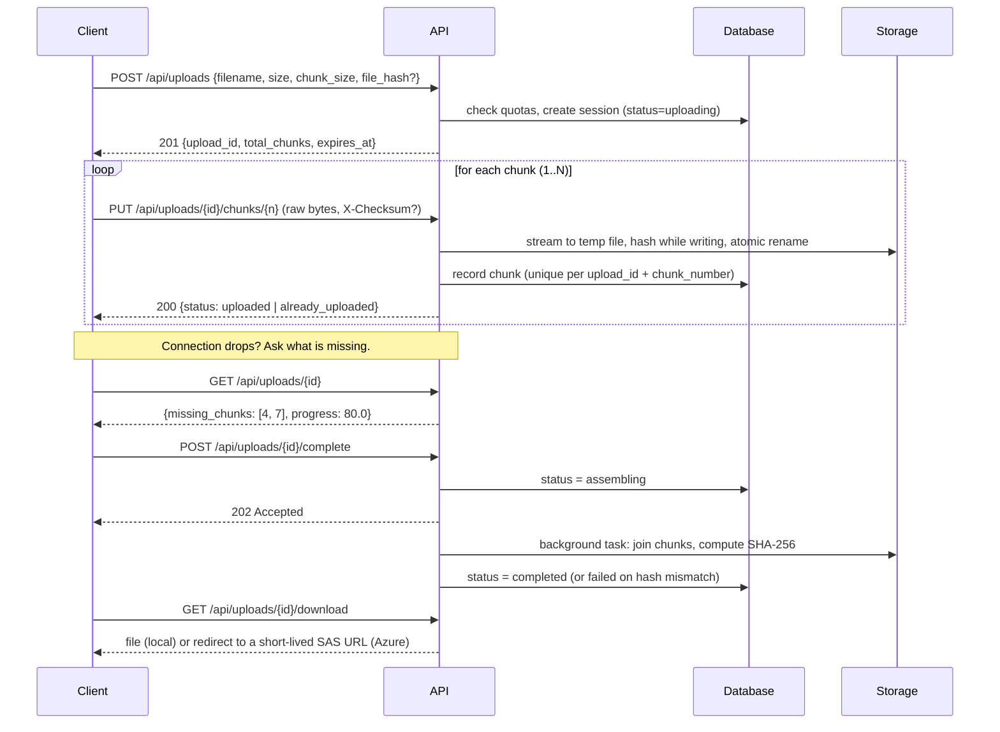
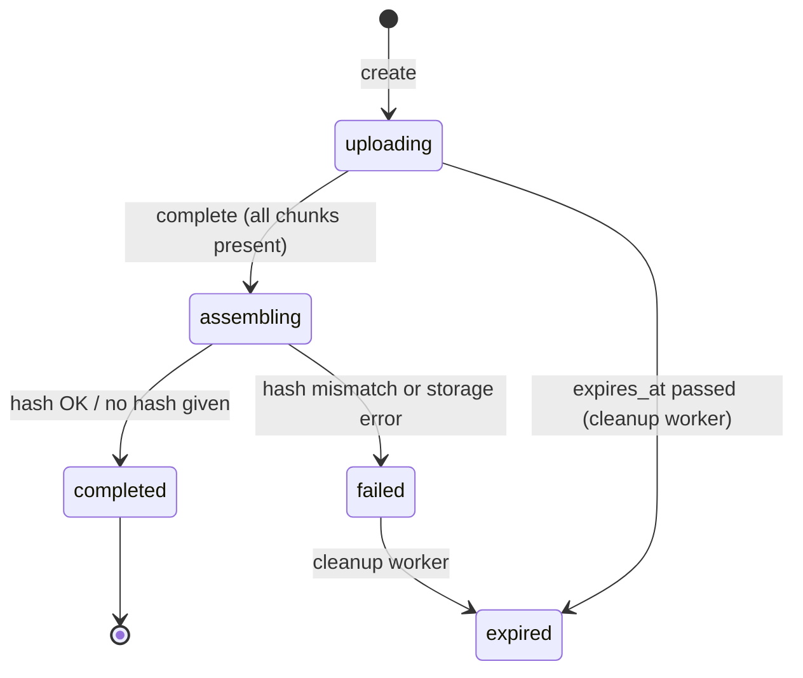

# Resumable Upload Service

[](https://github.com/vika-spec/resumable-upload-service/actions/workflows/ci.yml)


A backend service for uploading large files reliably over unreliable connections. The client splits a file into chunks, uploads them independently, and, if the connection drops, asks the server which chunks are missing and sends only those.

Built with FastAPI, SQLAlchemy, and JWT auth. Storage is pluggable between local disk (development) and Azure Blob Storage (production).

---

## Why this exists

**Live demo:** [https://uploaddemo48213app.azurewebsites.net](https://uploaddemo48213app.azurewebsites.net) &nbsp;|&nbsp; **API docs (Swagger):** [/docs](https://uploaddemo48213app.azurewebsites.net/docs)

> Hosted on Azure App Service with PostgreSQL and Blob Storage using student credits. If the link is slow to load or offline, the instance may be asleep or stopped. See [Quick start](#quick-start) to run it yourself in a minute.

A single `POST` of a multi-gigabyte file fails if the connection drops at 99%. This service makes interruptions cheap:

- **Resumable:** upload state lives on the server, so a client can resume after a crash, a network change, or a closed laptop.
- **Idempotent:** re-sending a chunk is safe, so clients can retry blindly.
- **Verified:** per-chunk checksums catch corruption in transit, and an optional whole-file SHA-256 is checked after assembly.
- **Abuse-resistant:** quotas, concurrency caps, expiry, and rate limits keep storage and cost bounded.

---

## How a resumable upload works



### Upload lifecycle



---

## Features

| Area | Details |
|---|---|
| **Uploads** | Chunked, resumable, 1-indexed chunks, status endpoint listing missing chunks, paginated listing, delete, download |
| **Integrity** | Optional `X-Checksum` (SHA-256) per chunk, optional whole-file `file_hash` verified after assembly |
| **Idempotency** | Unique constraint on `(upload_id, chunk_number)`, so duplicate chunk requests return `already_uploaded` |
| **Concurrency** | Row-level locks (`SELECT ... FOR UPDATE`) on upload sessions, plus a PostgreSQL advisory lock around global quota checks |
| **Auth** | Register/login, JWT (HS256), Argon2 password hashing, token refresh |
| **Limits** | Per-user storage, global storage, daily upload sessions, active uploads per user and globally, max file size, chunk size bounds |
| **Rate limiting** | Per-endpoint limits via `slowapi` (for example 5 session creations/min, 60 chunk uploads/min) |
| **Cleanup** | Background worker expires stale sessions and removes their stored chunks; uploads stuck mid-assembly after a server restart are handed back to the client |
| **Storage** | Local disk (default) or Azure Blob Storage (set a connection string); Azure downloads use short-lived SAS URLs |
| **Observability** | Structured JSON logs (`structlog`), `X-Request-ID` header, `/health` endpoint |
| **Admin** | `/api/admin/stats`: users, uploads by status, storage and quota use, top uploaders, recent activity. The admin account is created from environment variables and its username can't be registered publicly |
| **Frontend** | Minimal browser client in `static/index.html`, served at `/` |
| **Quality** | pytest suite (auth, uploads, admin, rate limiting, health, cleanup); CI on Python 3.11 and 3.12 plus a Docker build check |

---

## Quick start

### Local

```bash
git clone https://github.com/vika-spec/resumable-upload-service.git
cd resumable-upload-service

python -m venv .venv
source .venv/bin/activate        # Windows: .venv\Scripts\activate
pip install -r requirements.txt

cp .env.example .env             # Windows: copy .env.example .env
python -c "import secrets; print(secrets.token_hex(32))"   # paste into SECRET_KEY in .env
# Optional: set ADMIN_PASSWORD in .env to create the admin account on first start

uvicorn main:app --reload
```

The app refuses to start without a real `SECRET_KEY`.

- App and demo UI: <http://127.0.0.1:8000>
- Interactive API docs: <http://127.0.0.1:8000/docs>

SQLite and local-disk storage are used by default, so no other setup is needed.

### Docker (PostgreSQL)

```bash
cp .env.example .env     # then set SECRET_KEY (and ADMIN_PASSWORD) in .env
docker compose up --build
```

This starts PostgreSQL 16 and the API on port 8000, with uploads persisted to `./storage`. Compose refuses to start if `SECRET_KEY` is missing, and the database port is not published to the host.

### Run the tests

```bash
pytest tests/ -v
```

---

## API walkthrough

All upload endpoints require `Authorization: Bearer <token>`.

### 1. Register and log in

```bash
curl -X POST http://127.0.0.1:8000/api/auth/register \
  -H "Content-Type: application/json" \
  -d '{"username":"alice","email":"alice@example.com","password":"correct-horse-battery"}'

# Login uses OAuth2 form encoding, not JSON
curl -X POST http://127.0.0.1:8000/api/auth/login \
  -d "username=alice&password=correct-horse-battery"
# -> {"access_token":"...","token_type":"bearer"}
```

### 2. A complete client in Python

```python
import hashlib, os, time, requests

API   = "http://127.0.0.1:8000/api"
CHUNK = 5 * 1024 * 1024          # must stay the same when resuming


def sha256_file(path):
    h = hashlib.sha256()
    with open(path, "rb") as f:
        for block in iter(lambda: f.read(1 << 20), b""):
            h.update(block)
    return h.hexdigest()


def upload(path, token, upload_id=None):
    auth = {"Authorization": f"Bearer {token}"}

    # Start a new session, or pass upload_id to resume an existing one
    if upload_id is None:
        r = requests.post(f"{API}/uploads", headers=auth, json={
            "filename": os.path.basename(path),
            "size": os.path.getsize(path),
            "chunk_size": CHUNK,
            "file_hash": sha256_file(path),   # optional, verified after assembly
        })
        r.raise_for_status()
        upload_id = r.json()["upload_id"]

    # Ask the server what it still needs
    status = requests.get(f"{API}/uploads/{upload_id}", headers=auth).json()

    with open(path, "rb") as f:
        for n in status["missing_chunks"]:
            f.seek((n - 1) * CHUNK)
            data = f.read(CHUNK)
            requests.put(
                f"{API}/uploads/{upload_id}/chunks/{n}",
                headers={**auth, "X-Checksum": hashlib.sha256(data).hexdigest()},
                data=data,
            ).raise_for_status()

    # Trigger background assembly, then poll until it finishes
    requests.post(f"{API}/uploads/{upload_id}/complete", headers=auth).raise_for_status()
    while True:
        s = requests.get(f"{API}/uploads/{upload_id}", headers=auth).json()
        if s["status"] in ("completed", "failed"):
            return s
        time.sleep(1)
```

To resume after a crash, call `upload(path, token, upload_id="up_...")`. Only the missing chunks are sent.

### Endpoints

| Method | Path | Purpose | Rate limit |
|---|---|---|---|
| POST | `/api/auth/register` | Create account | 3/min |
| POST | `/api/auth/login` | Get JWT | 10/min |
| GET | `/api/auth/me` | Current user | 60/min |
| POST | `/api/auth/refresh` | New token from a valid one | 5/min |
| POST | `/api/uploads` | Create upload session | 5/min |
| PUT | `/api/uploads/{id}/chunks/{n}` | Upload one chunk (raw body) | 60/min |
| GET | `/api/uploads/{id}` | Status, progress, missing chunks | 60/min |
| POST | `/api/uploads/{id}/complete` | Start assembly (returns 202) | 10/min |
| GET | `/api/uploads/{id}/download` | Download the finished file | 20/min |
| DELETE | `/api/uploads/{id}` | Delete upload and stored data | 20/min |
| GET | `/api/uploads?skip=0&limit=20` | List your uploads (paginated) | 30/min |
| GET | `/api/admin/stats` | Service overview (admin only) | 10/min |
| GET | `/health` | Liveness and DB check | none |

---

## Configuration

Set via environment variables (see `.env.example`).

| Variable | Default | Meaning |
|---|---|---|
| `DATABASE_URL` | `sqlite:///./uploads.db` | SQLAlchemy URL; use `postgresql://...` in production |
| `SECRET_KEY` | none (**required**) | JWT signing key; the app will not start without it |
| `TOKEN_EXPIRY_HOURS` | `24` | Access token lifetime |
| `CORS_ORIGINS` | `http://localhost:3000,http://localhost:8000` | Allowed origins, comma-separated |
| `UPLOAD_EXPIRY_HOURS` | `2` | Session lifetime before the cleanup worker removes it |
| `MAX_FILE_SIZE_GB` | `10` | Largest allowed file |
| `MIN_CHUNK_SIZE_MB` / `MAX_CHUNK_SIZE_MB` | `1` / `50` | Allowed chunk size range |
| `QUOTA_USER_STORAGE_GB` | `1` | Per-user reserved and used storage |
| `QUOTA_GLOBAL_GB` | `40` | Total storage across all users |
| `QUOTA_DAILY_UPLOADS` | `3` | Upload sessions per user per day |
| `MAX_ACTIVE_UPLOADS_PER_USER` | `3` | Concurrent in-progress uploads per user |
| `MAX_ACTIVE_UPLOADS_GLOBAL` | `100` | Concurrent in-progress uploads overall |
| `CLEANUP_INTERVAL_SECONDS` | `300` | How often the cleanup worker runs |
| `ASSEMBLY_TIMEOUT_MINUTES` | `60` | If a server restart interrupts assembly, the upload is handed back to the client after this long |
| `ADMIN_USERNAME` | `admin` | Reserved username of the admin account (cannot be registered publicly) |
| `ADMIN_PASSWORD` | empty | Creates the admin account on first start; leave empty to disable admin access entirely |
| `AZURE_STORAGE_CONNECTION_STRING` | empty | Set to switch storage to Azure Blob |
| `AZURE_STORAGE_CONTAINER` | `uploads` | Azure container name |
| `LOG_FORMAT` / `LOG_LEVEL` | `json` / `INFO` | Logging output |

> Note: the per-user quota (1 GB) is lower than the max file size (10 GB) by default. Raise `QUOTA_USER_STORAGE_GB` if you want to accept files above 1 GB.

---

## Project structure

```text
.
├── main.py                  # App setup, middleware, health check, router wiring
├── database.py              # Engine, session factory (SQLite or pooled PostgreSQL)
├── models.py                # User, Upload, UploadChunk, UploadStatus
├── schemas.py               # Pydantic request/response models and validation
├── deps.py                  # get_current_user dependency (JWT -> User)
├── limiter_config.py        # slowapi limiter instance
├── logger.py                # structlog configuration
├── routes/
│   ├── auth.py              # register, login, me, refresh
│   ├── uploads.py           # upload lifecycle, quotas, background assembly
│   └── admin.py             # stats endpoint
├── services/
│   ├── auth_service.py      # Argon2 hashing, JWT encode/decode
│   └── storage_service.py   # Local disk / Azure Blob behind one interface
├── workers/
│   └── cleanup.py           # Expires stale uploads on an interval
├── static/index.html        # Demo browser client
├── tests/                   # pytest: auth, uploads, admin, rate limiting, health, cleanup
├── Dockerfile               # Multi-stage build, non-root user, healthcheck, honors $PORT
├── .dockerignore            # Keeps secrets and local state out of the image
├── docker-compose.yml       # App + PostgreSQL
└── .github/workflows/ci.yml # Tests on 3.11/3.12 + Docker build check
```

---

## Design decisions

- **Server-side state, not client-side.** Chunk records are in the database, so any client can resume by asking `GET /uploads/{id}`. The client never has to remember what it sent.
- **Idempotency through a database constraint.** A unique index on `(upload_id, chunk_number)` makes duplicate and racing requests safe without application-level bookkeeping.
- **Streamed writes with atomic rename.** Chunks are hashed while streaming to a uniquely named `.tmp` file and renamed only when complete, so a dropped connection never leaves a half-written chunk that looks valid, and concurrent requests for the same chunk can't collide.
- **Corruption costs one chunk, not the upload.** The `X-Checksum` is verified before a chunk is stored. A mismatch returns `400`, stores nothing, and leaves the session and all other chunks intact, so the client just re-sends that chunk.
- **Recoverable assembly.** Entering `assembling` sets a deadline. If the server restarts mid-assembly, the cleanup worker returns the upload to `uploading` with a fresh expiry, and the client calls `/complete` again.
- **Assembly runs in the background.** `POST /complete` returns `202` immediately and a background task joins chunks, so large files don't block a request or hit proxy timeouts. Clients poll the status endpoint.
- **Quotas count reserved bytes.** Storage is counted from the declared file size at session creation, not as bytes arrive, so one user can't start many uploads that together exceed the limit. On PostgreSQL an advisory lock serialises the global quota check.
- **One storage interface, two backends.** The routes never know whether chunks live on disk or in Azure; switching is a single environment variable.
- **Direct downloads on Azure.** Downloads redirect to a 15-minute SAS URL so file bytes don't flow through the API server.

---

## Security notes

- Passwords are hashed with Argon2; JWTs are signed with `SECRET_KEY`. The app refuses to start if `SECRET_KEY` is missing or still the placeholder.
- Filenames are validated to reject path separators and null bytes.
- Every upload endpoint is scoped to the authenticated user; accessing someone else's upload returns 404.
- The admin username is reserved, so it can't be claimed through `/register`. The admin account exists only if you set `ADMIN_PASSWORD`; use a strong one.
- Set `CORS_ORIGINS` to your real frontend origins.
- The Docker image trusts `X-Forwarded-For` (`FORWARDED_ALLOW_IPS="*"`) so per-IP rate limits see real client IPs behind a platform proxy. If the container is also reachable directly, set `FORWARDED_ALLOW_IPS` to your proxy's address instead.
- `.dockerignore` keeps `.env`, local databases, and uploaded files out of the image.

---

## Deployment

The service needs a **long-running container or VM** (the cleanup worker and background assembly run inside the app), so serverless platforms such as Vercel or AWS Lambda are not suitable. Requirements:

- **PostgreSQL** via `DATABASE_URL` (SQLite is for local development only)
- **Persistent storage**: set `AZURE_STORAGE_CONNECTION_STRING` for Azure Blob, or mount a persistent disk. Many free tiers wipe the local disk on every redeploy.
- **Chunk size**: each chunk is one HTTP request and many proxies cap request bodies, so use 5-10 MB chunks in production.
- **A single instance**, since the cleanup worker is in-process.
- Required environment variables: `SECRET_KEY`, `DATABASE_URL`, `CORS_ORIGINS`. Recommended: `ADMIN_PASSWORD`, plus the `AZURE_*` variables for Blob storage.
- Health check path: `/health`. The container listens on `$PORT` (default 8000).

Example setup (Render + Azure Blob):

1. Create an Azure Storage account and a container named `uploads`; copy its connection string.
2. On Render, create a PostgreSQL database and copy its URL.
3. Create a Render Web Service from this repo (runtime: Docker, health check path `/health`) and set the environment variables above.
4. Open `/docs`, register a user, and upload a file end to end.

An all-Azure setup (App Service or Container Apps + Azure Database for PostgreSQL + Blob Storage) works the same way, and a VPS can run `docker compose up -d` behind a reverse proxy such as Caddy.

---

## Roadmap

- Alembic migrations instead of `create_all`
- Range requests for resumable downloads
- Refresh tokens and token revocation
- S3-compatible storage backend
- Move the cleanup worker to a separate scheduled process for multi-instance deployments

---

## License

Add a license of your choice (MIT is a common default) as `LICENSE`.